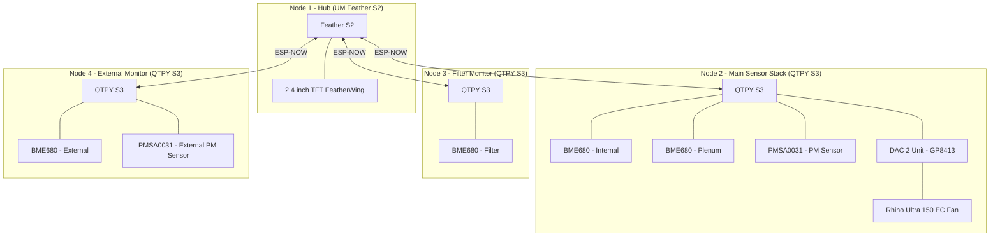

# Electronics Design & Control Logic

The CLV-3D system follows a distributed design using ESP-NOW for wireless communication between a main display hub, a centralized sensor stack, and dedicated environmental monitors.

## System Architecture

## Node Pinouts

### Node 1: Main Hub (Feather S2)

| Pin | Component | Interface | Note |
| :--- | :--- | :--- | :--- |
| 1 | TFT_CS (LCD) | SPI | Chip Select for Display |
| 3 | TFT_DC (LCD) | SPI | Data/Command for Display |
| 33 | SD_CS (SD Card) | SPI | Chip Select for SD |
| 38 | STMPE_CS (Touch) | SPI | Chip Select for Resistive Touch |
| SCK/MO/MI | TFT/Touch/SD | SPI | Shared SPI |
| D5 | TFT Backlight | PWM | |

### Node 2: Main Sensor Stack (QTPY S3)

| Pin | Component | Interface | Note |
| :--- | :--- | :--- | :--- |
| SDA/SCL | BME680 (Internal) | I2C | STEMMA QT |
| SDA/SCL | BME680 (Plenum) | I2C | STEMMA QT |
| SDA/SCL | PMSA0031 (PM) | I2C | STEMMA QT |
| SDA/SCL | DAC 2 Unit (GP8413) | I2C (0x59) | V0 (Channel 0) for 0-10V Fan Control |

### Node 3: Filter Monitor (QTPY S3)

| Pin | Component | Interface | Note |
| :--- | :--- | :--- | :--- |
| SDA/SCL | BME680 (Filter) | I2C | STEMMA QT |

### Node 4: External Monitor (QTPY S3)

| Pin | Component | Interface | Note |
| :--- | :--- | :--- | :--- |
| SDA/SCL | BME680 (External) | I2C | STEMMA QT |
| SDA/SCL | PMSA0031 (PM External) | I2C | STEMMA QT |

### Hardware Configuration Notes

- **Communication**: ESP-NOW eliminates the need for data cables between nodes. Each node acts as a wireless station.
- **Fan Control**: The GP8413 provides a 0-10V analog signal from **Channel 0 (V0)** to the Rhino Ultra 150 EC fan.
- **Initialization**: Firmware initializes the DAC to a 10V range by writing `0x11` to register `0x01` on startup.

---

## Control Logic

The system operates autonomously, adjusting fan speed based on air quality and monitoring filter health via differential pressure.

### 1. VOC-Adaptive Fan Control (Hybrid Gradient)

- **Input**: BME680 (Internal) VOC IAQ Index (0-500 scale).
- **Output**: 0-10V DAC Signal to Rhino Ultra 150 EC.
- **Baseline**: 20% speed (~120 m³/h) for constant circulation when IAQ < 50.
- **Gradient**: Proportional ramp from 20% to 80% as IAQ index rises from 50 to 200.
- **Peak**: 100% speed if IAQ index exceeds 300 or Particulate Matter (PM2.5) exceeds 50 µg/m³.
- **Smoothing**: Exponential Moving Average (EMA) with a 0.2 smoothing factor to prevent rapid speed changes.

### 2. Adaptive "Smart Idle" Mode

- **Condition**: If Internal IAQ < 10 for > 1 hour, the fan drops to **0% speed**.
- **Adaptive Sniffing**:
  - **Standard**: 2 mins at 20% every 6 hours (if idle < 24h).
  - **Deep Sleep**: 2 mins at 20% every 24 hours (if idle > 24h).
- **Instant Wake**: Fan resumes active operation if IAQ > 50 or PM2.5 > 15.
- **Manual Mode Interruption**: Entering or exiting manual fan control immediately interrupts Smart Idle and resets the 1-hour clean countdown timer.

### 3. G4 Filter Monitoring (Differential Pressure)

- **Method**: Comparison between Node 2 (Plenum) and Node 3 (Filter) BME680 pressure readings.
- **Threshold**: Final Pressure Drop = 250 Pa (normalized for current fan speed).
- **Alert**: "Replace G4 Filter" warning displayed on Node 1 when the normalized delta exceeds 250 Pa.

### 4. Carbon Filter Efficiency Monitoring

- **Method**: Comparison of VOC levels before and after the carbon bed (Internal vs. Plenum).
- **Calculation**: Efficiency = (VOC_in - VOC_out) / VOC_in.
- **Evaluation Gate**: Gated at Internal IAQ > 75.0 to ensure a mathematically reliable signal-to-noise ratio.
- **Two-Tier Alert System**:
  - **Level 1 Warning (Amber CLR_WARN)**: Triggered if efficiency drops below **70%** continuously for **15 minutes**. Displays !! CHECK CARBON FILTER !!.
  - **Level 2 Critical (Red CLR_BAD)**: Triggered if efficiency drops below **50%** continuously for **20 minutes**. Displays !! REPLACE CARBON FILTER !!.
- **Pause Gates & True Timer Freeze**:
  - **High Humidity Gate (>60% RH)**: High moisture temporarily clogs carbon micropores. Monitoring is frozen and the Hub displays a dedicated **Purple (CLR_PURPLE)** banner: !! HIGH HUMIDITY (>60%) - PAUSED !!.
  - **External Event Shield (Room IAQ > 50)**: Cooking or cleaning fumes in the flat freeze carbon evaluation, preventing external spikes from triggering false filter warnings.

### 5. Safe Self-Healing VOC System

To ensure sensors adapt to long-term hardware aging without corrupting calibration:

- **Upward Peak-Seeking**: When cleaner air is detected, baseline steps upward using a smooth EWMA filter (weight = 0.05), capped between 10kΩ and 1,500kΩ.
- **Safe Downward Drift Ceiling (<25 IAQ)**: Downward drift is strictly locked out unless IAQ is below **25.0** for 15 minutes. This ensures resting resin or IPA vapor (typically 30–70 IAQ) is never adopted as "clean air baseline."
- **Plenum Drift Protection**: During active airflow (>10% fan speed), if the plenum sensor drifts higher than the cabinet internal sensor by >5 IAQ, its baseline is automatically corrected.
- **Persistence**: Baselines checkpoint to ESP32 flash (NVS) every 5 minutes when changes exceed 0.5%.

---

## Hub User Interface

The Hub (Node 1) provides the primary interface for monitoring system health and air quality.

- **Display**: 320x240 Landscape mode with dual-page touch navigation (Dashboard vs. System Status).
- **Diagnostics**: Real-time Node RSSI (dBm) and heartbeat indicators for all wireless sensors.
- **Alert Hierarchy**:
  - **Red (CLR_BAD)**: !! CLOGGED FILTERS !!, !! REPLACE CARBON FILTER !!, !! REPLACE G4 FILTER !! (Critical maintenance).
  - **Amber (CLR_WARN)**: !! CHECK CARBON FILTER !! (Single-pass efficiency < 70%).
  - **Purple (CLR_PURPLE)**: !! HIGH HUMIDITY (>60%) - PAUSED !! (Moisture advisory).
  - **Slate Blue (CLR_HEADER)**: AIR QUALITY DASHBOARD (Normal operation).
- **Power Management**: Backlight automatically dims after 5 minutes of inactivity and turns off after 15 minutes. Wake-on-touch is supported.

---
*This project is licensed under [CC BY-NC-SA 4.0](https://creativecommons.org/licenses/by-nc-sa/4.0/).*
